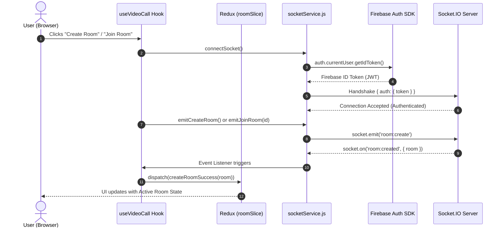

# QuickChat Client — Socket.IO & Real-Time Room Architecture

A comprehensive, step-by-step guide explaining how real-time Socket.IO communication, Firebase authentication handshake, Redux state management, and room lifecycles work in the QuickChat client.

---

## Table of Contents

1. [High-Level Overview](#high-level-overview)
2. [Socket Client Architecture](#socket-client-architecture)
3. [Step-by-Step Socket Lifecycle](#step-by-step-socket-lifecycle)
   - [Step 1: Firebase Token Acquisition](#step-1-firebase-token-acquisition)
   - [Step 2: Authenticated Handshake](#step-2-authenticated-handshake)
   - [Step 3: Creating a Room](#step-3-creating-a-room)
   - [Step 4: Joining a Room](#step-4-joining-a-room)
   - [Step 5: Peer Arrival & Bidirectional Sync](#step-5-peer-arrival--bidirectional-sync)
   - [Step 6: Leaving & Disconnection Cleanup](#step-6-leaving--disconnection-cleanup)
4. [Redux Integration & State Flow](#redux-integration--state-flow)
5. [Hook Orchestration (`useVideoCall`)](#hook-orchestration-usevideocall)
6. [Complete Step-by-Step Example (Alice & Bob)](#complete-step-by-step-example-alice--bob)
7. [Error Handling & Edge Cases](#error-handling--edge-cases)

---

## High-Level Overview

QuickChat implements a **Zero-Trust Client Socket Architecture**:
- The client **never** specifies its user ID (`uid`), display name, or role in event payloads.
- Authentication occurs exclusively during the Socket.IO connection handshake via a signed **Firebase ID Token**.
- The server decodes and cryptographically verifies the token, attaching the trusted user profile to the socket session.
- All room actions (`room:create`, `room:join`, `room:leave`) use this verified server-side identity.



---

## Socket Client Architecture

The client-side real-time layer is split into 4 cleanly decoupled tiers:

```text
┌────────────────────────────────────────────────────────┐
│ UI Components (VideoCallPage, Create/JoinRoomCards)     │
└───────────────────────────┬────────────────────────────┘
                            │ Reads State & User Actions
┌───────────────────────────▼────────────────────────────┐
│ Custom Hook (useVideoCall.js)                          │
│ - Orchestrates socket listeners & unmount cleanup      │
│ - Connects on demand / mount                           │
│ - Dispatches actions to Redux store                    │
└─────────────┬────────────────────────────┬─────────────┘
              │ Calls Service Methods      │ Dispatches State
┌─────────────▼──────────────┐ ┌───────────▼─────────────┐
│ socketService.js           │ │ Redux Toolkit           │
│ - Singleton socket client  │ │ (roomSlice.js)          │
│ - Token handshake & refresh│ │ - currentRoom           │
│ - Reconnection deduplication│ │ - socketConnected       │
│ - Pure emission functions  │ │ - isCreating / isJoining│
└─────────────┬──────────────┘ └─────────────────────────┘
              │ WSS / Polling
┌─────────────▼──────────────┐
│ Backend Socket.IO Server   │
└────────────────────────────┘
```

### Key Files in `client/`:

| File | Purpose |
|---|---|
| [`client/src/services/socketService.js`](file:///d:/MERN/Antigravity/quickChat/client/src/services/socketService.js) | Singleton client service managing socket connection, Firebase token acquisition, reconnection, and event emissions. |
| [`client/src/store/slices/roomSlice.js`](file:///d:/MERN/Antigravity/quickChat/client/src/store/slices/roomSlice.js) | Redux slice storing room snapshot (`currentRoom`), status, connection indicators, and error messages. |
| [`client/src/pages/video-call/hooks/useVideoCall.js`](file:///d:/MERN/Antigravity/quickChat/client/src/pages/video-call/hooks/useVideoCall.js) | React hook binding Socket.IO events to Redux actions and handling clipboard copying, form inputs, and component cleanup. |
| [`client/src/pages/video-call/VideoCallPage.jsx`](file:///d:/MERN/Antigravity/quickChat/client/src/pages/video-call/VideoCallPage.jsx) | Main view presenting room creation, joining, active room cards, and call status. |

---

## Step-by-Step Socket Lifecycle

### Step 1: Firebase Token Acquisition

Before opening a WebSocket connection, `socketService.js` queries the Firebase client SDK:

```javascript
// client/src/services/socketService.js
export async function getAuthToken(forceRefresh = false) {
  const currentUser = auth.currentUser;
  if (!currentUser) {
    throw new Error('Authentication required: please log in before connecting.');
  }
  return await currentUser.getIdToken(forceRefresh);
}
```

- If no user is logged in, an error is thrown, preventing unauthorized connections.
- If the token is about to expire, `getIdToken(true)` forces a token refresh.

### Step 2: Authenticated Handshake

When `connectSocket()` is invoked, it passes the token in Socket.IO's `auth` payload:

```javascript
// client/src/services/socketService.js
socketInstance = io(SOCKET_URL, {
  auth: { token },
  autoConnect: false,
  reconnection: true,
  reconnectionAttempts: 5,
  reconnectionDelay: 1000,
  transports: ['websocket', 'polling'],
});
```

**What happens under the hood:**
1. Socket.IO initiates an HTTP GET request with query params and headers including the `auth` object.
2. The server's `socketAuthMiddleware` extracts `socket.handshake.auth.token`.
3. The server validates the token using `admin.auth().verifyIdToken(token)`.
4. If valid, the connection is approved. If expired or invalid, the server emits `connect_error`.
5. If an auth error occurs, `socketService.js` intercepts it, requests a fresh token with `getAuthToken(true)`, updates `socketInstance.auth = { token: freshToken }`, and retries.

### Step 3: Creating a Room

When a user clicks **"Create Room"**:

1. **Trigger**: `handleCreateRoom` in `useVideoCall.js` is invoked.
2. **Redux Dispatch**: `dispatch(createRoomStart())` sets `isCreating: true`.
3. **Socket Check**: Ensures socket is connected via `await connectSocket()`.
4. **Emit**: Calls `emitCreateRoom()`:
   ```javascript
   // client/src/services/socketService.js
   export function emitCreateRoom() {
     if (!socketInstance?.connected) {
       throw new Error('Socket is not connected. Unable to create room.');
     }
     socketInstance.emit('room:create');
   }
   ```
   *Notice: No payload is sent! The server knows who you are from your authenticated handshake.*
5. **Server Reply**: Server creates the room and emits `room:created` back to the client:
   ```json
   {
     "room": {
       "id": "u4Kl8_91bCq-d10mKz",
       "hostUid": "firebase-uid-alice",
       "status": "waiting",
       "participants": [
         { "uid": "firebase-uid-alice", "joinedAt": 1729000000000 }
       ],
       "createdAt": 1729000000000,
       "endedAt": null
     }
   }
   ```
6. **Store Update**: The listener in `useVideoCall.js` receives `room:created` and dispatches `createRoomSuccess(room)`, setting `currentRoom` in Redux and clearing loading flags.

### Step 4: Joining a Room

When another user enters a Room ID and clicks **"Join Room"**:

1. **Input Validation**: Client checks that `roomId` is a non-empty string.
2. **Redux Dispatch**: `dispatch(joinRoomStart())` sets `isJoining: true`.
3. **Emit**: Calls `emitJoinRoom(trimmedId)`:
   ```javascript
   // client/src/services/socketService.js
   export function emitJoinRoom(roomId) {
     socketInstance.emit('room:join', { roomId: roomId.trim() });
   }
   ```
4. **Server Validation**: Server checks:
   - Does room exist?
   - Has room ended?
   - Is room full (already 2 participants)?
   - Is the user already in the room?
5. **Server Reply**:
   - To the joiner: Emits `room:joined` with `{ room: RoomSnapshot }`.
   - To the host: Emits `room:peer-joined` with `{ room: RoomSnapshot, peer: { uid } }`.
6. **Store Update**: Joiner dispatches `joinRoomSuccess(room)`, setting status to `'active'`.

### Step 5: Peer Arrival & Bidirectional Sync

When Joiner enters:
- The Host receives `room:peer-joined`:
  ```json
  {
    "room": {
      "id": "u4Kl8_91bCq-d10mKz",
      "hostUid": "firebase-uid-alice",
      "status": "active",
      "participants": [
        { "uid": "firebase-uid-alice", "joinedAt": 1729000000000 },
        { "uid": "firebase-uid-bob", "joinedAt": 1729000015000 }
      ],
      "createdAt": 1729000000000,
      "endedAt": null
    },
    "peer": {
      "uid": "firebase-uid-bob"
    }
  }
  ```
- Redux executes `peerJoined(data)`:
  - Updates `currentRoom.status` to `'active'`.
  - Sets `successMessage` to `"Peer connected to the room!"`.
  - Both screens now render "Connected (2/2)" with green indicator badges.

### Step 6: Leaving & Disconnection Cleanup

When either participant leaves:
- **Voluntary Leave**: User clicks **"Leave Room"**:
  ```javascript
  emitLeaveRoom(); // socket.emit('room:leave')
  dispatch(leaveRoomAction());
  ```
- **Involuntary Disconnect**: User closes tab, browser crashes, or network disconnects. Socket transport detects disconnection and runs identical cleanup on the server.
- **Peer Notification**:
  - If 1 user remains, server emits `room:left` with `{ roomId, uid }`. The remaining user's client dispatches `peerLeft`, removing the peer and switching room status back to `'waiting'`.
  - If 0 users remain, server emits `room:ended` with `{ roomId }`. The client clears the room and resets state.

---

## Redux Integration & State Flow

The Redux store (`client/src/store/slices/roomSlice.js`) tracks the complete lifecycle:

```javascript
const initialState = {
  currentRoom: null,      // Active RoomSnapshot or null
  isCreating: false,       // Spinner during room:create
  isJoining: false,        // Spinner during room:join
  error: null,             // Validation or server error string
  successMessage: null,    // User-facing feedback alert
  socketConnected: false,  // Connection status flag
  socketError: null,       // Handshake or network failure
};
```

### Action Reducer Map:

| Action | Payload | State Transformation |
|---|---|---|
| `setSocketConnected` | `boolean` | Updates `socketConnected`. Clears `socketError` when true. |
| `setSocketError` | `string` | Sets `socketError`. |
| `createRoomStart` | None | `isCreating = true`, `error = null`. |
| `createRoomSuccess` | `RoomSnapshot` | `isCreating = false`, `currentRoom = action.payload`. |
| `createRoomFailure` | `string` | `isCreating = false`, `error = action.payload`. |
| `joinRoomStart` | None | `isJoining = true`, `error = null`. |
| `joinRoomSuccess` | `RoomSnapshot` | `isJoining = false`, `currentRoom = action.payload`. |
| `joinRoomFailure` | `string` | `isJoining = false`, `error = action.payload`. |
| `peerJoined` | `{ room, peer }` | Updates `currentRoom = action.payload.room`. |
| `peerLeft` | `{ roomId, uid }` | Removes peer from `currentRoom.participants`, sets status to `'waiting'`. |
| `roomEnded` | `{ roomId }` | Sets `currentRoom = null`, sets error to `"The room session has ended."`. |
| `leaveRoomAction` | None | Resets room state to `null`. |

---

## Hook Orchestration (`useVideoCall`)

The `useVideoCall` custom hook contains all socket event registration and Redux interactions.

### Listener Attachment Pattern:
```javascript
useEffect(() => {
  let currentSocket = getSocket();

  const handleRoomCreated = ({ room }) => dispatch(createRoomSuccess(room));
  const handleRoomJoined = ({ room }) => dispatch(joinRoomSuccess(room));
  const handlePeerJoined = (data) => dispatch(peerJoined(data));
  const handleRoomLeft = (data) => dispatch(peerLeft(data));
  const handleRoomEnded = (data) => dispatch(roomEnded(data));
  const handleRoomError = ({ message }) => {
    dispatch(createRoomFailure(message));
    dispatch(joinRoomFailure(message));
  };

  const attachListeners = (s) => {
    // Avoid double-binding by detaching first
    detachListeners(s);
    s.on('room:created', handleRoomCreated);
    s.on('room:joined', handleRoomJoined);
    s.on('room:peer-joined', handlePeerJoined);
    s.on('room:left', handleRoomLeft);
    s.on('room:ended', handleRoomEnded);
    s.on('room:error', handleRoomError);
  };

  if (user) {
    connectSocket().then((s) => {
      attachListeners(s);
    });
  }

  // Cleanup on unmount
  return () => {
    if (currentSocket) detachListeners(currentSocket);
  };
}, [user, dispatch]);
```

---

## Complete Step-by-Step Example (Alice & Bob)

Let's walk through an end-to-end scenario with two users: **Alice** (Host) and **Bob** (Peer).

```text
Timeline:
1. Alice connects & creates Room "XYZ123"
2. Server confirms room creation
3. Bob connects & joins Room "XYZ123"
4. Server connects Alice & Bob
5. Alice leaves the call
```

### 1. Alice connects and creates a room

```javascript
// Step 1: Alice's browser initializes socket
const tokenAlice = await auth.currentUser.getIdToken();
const socketAlice = io('http://localhost:5000', { auth: { token: tokenAlice } });

// Step 2: Alice clicks "Create Room"
socketAlice.emit('room:create');
```

**Server Event Received by Alice:**
```json
// Event: 'room:created'
{
  "room": {
    "id": "s7_H19xZa01KlM-2Nqp",
    "hostUid": "alice-uid-123",
    "status": "waiting",
    "participants": [
      { "uid": "alice-uid-123", "joinedAt": 1729000100000 }
    ],
    "createdAt": 1729000100000,
    "endedAt": null
  }
}
```
*Alice's UI displays:* Room ID `s7_H19xZa01KlM-2Nqp` with button **"Copy Room ID"** and badge **"Waiting for peer (1/2)"**.

---

### 2. Bob joins the room

Alice shares the ID `s7_H19xZa01KlM-2Nqp` with Bob.

```javascript
// Step 3: Bob enters ID and clicks "Join Room"
socketBob.emit('room:join', { roomId: 's7_H19xZa01KlM-2Nqp' });
```

**Events Emitted by Server:**

**To Bob (`room:joined`):**
```json
{
  "room": {
    "id": "s7_H19xZa01KlM-2Nqp",
    "hostUid": "alice-uid-123",
    "status": "active",
    "participants": [
      { "uid": "alice-uid-123", "joinedAt": 1729000100000 },
      { "uid": "bob-uid-456", "joinedAt": 1729000125000 }
    ],
    "createdAt": 1729000100000,
    "endedAt": null
  }
}
```

**To Alice (`room:peer-joined`):**
```json
{
  "room": {
    "id": "s7_H19xZa01KlM-2Nqp",
    "hostUid": "alice-uid-123",
    "status": "active",
    "participants": [
      { "uid": "alice-uid-123", "joinedAt": 1729000100000 },
      { "uid": "bob-uid-456", "joinedAt": 1729000125000 }
    ],
    "createdAt": 1729000100000,
    "endedAt": null
  },
  "peer": {
    "uid": "bob-uid-456"
  }
}
```

*Both Alice and Bob's UI now show:* **"Call Active (2/2)"**.

---

### 3. Alice leaves the call

Alice clicks **"Leave Room"**:

```javascript
socketAlice.emit('room:leave');
```

**Event Emitted to Bob (`room:left`):**
```json
{
  "roomId": "s7_H19xZa01KlM-2Nqp",
  "uid": "alice-uid-123"
}
```
*Bob's UI updates:* Host transfers to Bob. Room status reverts to **"Waiting for peer (1/2)"** with notification *"Peer has left the room."*

---

## Error Handling & Edge Cases

| Error Condition | Server Response | Client Behavior |
|---|---|---|
| Invalid / Expired Token | `connect_error: "Authentication error: invalid or expired token."` | `socketService.js` forces a fresh token refresh with `getIdToken(true)` and reattempts handshake. If unauthenticated, displays error and redirects to `/login`. |
| Room ID Not Found | `room:error: "Room 'xyz' does not exist."` | Redux sets `error = "Room 'xyz' does not exist."`, turns off loading spinner, displays red error alert. |
| Room Full (2 peers already inside) | `room:error: "Room 'xyz' is already full."` | Redux sets error message, user is prevented from entering. |
| Already in a room | `room:error: "You are already in room 'abc'..."` | Informs user to leave the active room first before creating or joining another. |
| Sudden Disconnect (tab closed) | Server runs `leaveRoom(uid)` | Remaining peer receives `room:left`. Server memory cleans up ended rooms after 5 minutes. |
