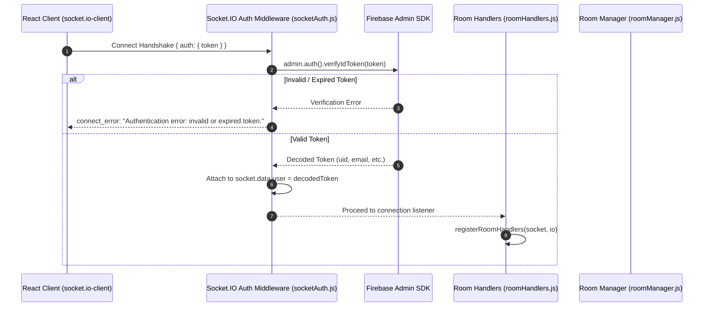
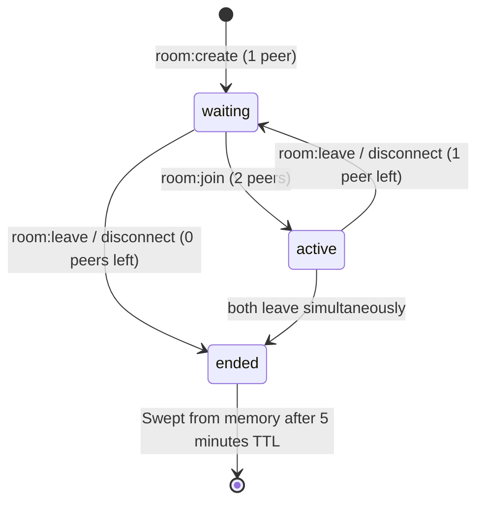

# QuickChat Server

Backend API and real-time Socket.IO signaling server built with Express, Socket.IO, and Firebase Admin SDK.

---

## Features

- **Express REST API**: Health checks and profile management routes with Firebase token verification middleware.
- **Socket.IO Real-Time Engine**: Real-time room management and signaling pipeline attached to the shared Node HTTP server.
- **Cryptographic Token Verification**: All Socket.IO handshake attempts verify the client's Firebase ID token via `firebase-admin` before granting connection access.
- **Zero-Trust Identity**: Client event payloads never pass or specify UIDs. All handlers resolve identity exclusively from `socket.data.user.uid`.
- **In-Memory Room Management**: One-to-one video call room state with participant limits, duplicate prevention, and automatic cleanup.

---

## Directory Structure

```text
server/
|-- src/
|   |-- config/
|   |   `-- firebase.js          # Firebase Admin SDK initialization
|   |-- controllers/
|   |   `-- authController.js    # Auth HTTP endpoints
|   |-- middlewares/
|   |   `-- authMiddleware.js    # Express bearer token verification
|   |-- routes/
|   |   `-- authRoutes.js        # API routing
|   |-- socket/
|       |-- index.js             # Socket.IO initialization and CORS setup
|       |-- socketAuth.js        # Socket handshake auth middleware
|       |-- roomHandlers.js      # Socket event listeners (room:create, room:join, etc.)
|       `-- roomManager.js       # In-memory room store and lifecycle state machine
|-- server.js                    # Entry point (Express + HTTP + Socket.IO)
|-- serviceAccountKey.json       # Firebase service account credentials (gitignored)
`-- package.json
```

---

## Environment Variables

Create `server/.env`:

```env
PORT=5000
CLIENT_URL=http://localhost:5173
```

Ensure `server/serviceAccountKey.json` is present with valid Firebase Admin credentials.

---

## Socket.IO Real-Time Architecture & Handshake

For an in-depth backend reference, see: [`server/src/docs/room_management_docs.md`](file:///d:/MERN/Antigravity/quickChat/server/src/docs/room_management_docs.md).

QuickChat enforces **Zero-Trust WebSocket Authentication**. The client never provides its `uid` in event payloads. Instead, identity is determined cryptographically during connection establishment.

### Authentication Sequence



1. **Handshake Interception (`socketAuth.js`)**:
   - `io.use(socketAuthMiddleware)` intercepts incoming socket handshakes.
   - Reads `socket.handshake.auth.token`.
   - Rejects the connection if the token is missing or fails `auth.verifyIdToken(token)`.
   - Stores the verified user payload in `socket.data.user`.
2. **Identity Resolution (`roomHandlers.js`)**:
   - Every handler extracts `const uid = socket.data.user.uid;`.
   - Spoofing or impersonating another user is impossible.

---

## Room Management State Machine

Each room transitions through predictable states:



- **`waiting`**: Room created by host; awaiting peer join (1/2 participants).
- **`active`**: Second participant joined; one-to-one call in progress (2/2 participants).
- **`ended`**: Room closed because all participants left. Retained for 5 minutes TTL to reject late joiners gracefully before memory garbage collection.

---

## Event Reference

### Client-to-Server (`socket.emit`)

| Event | Payload | Auth Source | Description |
|---|---|---|---|
| `room:create` | `{}` | `socket.data.user.uid` | Requests room creation. Rejects if user is already in a room. |
| `room:join` | `{ roomId: string }` | `socket.data.user.uid` | Requests joining an existing room. Rejects if room is missing, full, or ended. |
| `room:leave` | `{}` | `socket.data.user.uid` | Leaves the user's active room. Reverts room to `'waiting'` or marks `'ended'`. |
| `disconnect` | Built-in | `socket.data.user.uid` | Automatic transport disconnect. Invokes the same cleanup as `room:leave`. |

### Server-to-Client (`socket.on`)

| Event | Target | Payload | Description |
|---|---|---|---|
| `room:created` | Creator only | `{ room: RoomSnapshot }` | Confirms room created with crypto ID. |
| `room:joined` | Joiner only | `{ room: RoomSnapshot }` | Confirms joiner entered the room. |
| `room:peer-joined` | Existing host | `{ room: RoomSnapshot, peer: { uid } }` | Notifies host that the second peer has entered. |
| `room:left` | Remaining peer | `{ roomId: string, uid: string }` | Notifies peer that their partner left. |
| `room:ended` | All room members | `{ roomId: string }` | Emitted when room closes (all left). |
| `room:error` | Caller only | `{ message: string }` | Emitted on validation errors (e.g. room full). |

### Room Snapshot Data Shape

```json
{
  "id": "7mKx8_12aBcDeFgHiJkLm",
  "hostUid": "firebase-uid-creator",
  "status": "waiting | active | ended",
  "participants": [
    { "uid": "firebase-uid-creator", "joinedAt": 1718000000000 }
  ],
  "createdAt": 1718000000000,
  "endedAt": null
}
```
*Note: Socket IDs are strictly internal to the server and never exposed in `RoomSnapshot`.*

---

## Complete Step-by-Step Example

### Scenario: User A creates a room, User B joins, User A leaves.

#### 1. User A creates Room
- **Client A emits:**
  ```javascript
  socketA.emit('room:create');
  ```
- **Server processes:**
  - Validates `socketA.data.user.uid` is not already in a room.
  - Generates 22-character URL-safe ID: `a8K_9mX1Z0q...`.
  - Sets `hostUid = uidA`, `status = 'waiting'`.
  - Joins Socket.IO channel: `socketA.join('a8K_9mX1Z0q...')`.
- **Client A receives `room:created`:**
  ```json
  {
    "room": {
      "id": "a8K_9mX1Z0q...",
      "hostUid": "uid-A",
      "status": "waiting",
      "participants": [{ "uid": "uid-A", "joinedAt": 1729000000000 }],
      "createdAt": 1729000000000,
      "endedAt": null
    }
  }
  ```

#### 2. User B joins Room
- **Client B emits:**
  ```javascript
  socketB.emit('room:join', { roomId: 'a8K_9mX1Z0q...' });
  ```
- **Server processes:**
  - Validates room exists and `participants.size < 2`.
  - Adds `uid-B` to participants; updates `room.status = 'active'`.
  - Emits `room:peer-joined` to User A:
    ```json
    {
      "room": {
        "id": "a8K_9mX1Z0q...",
        "hostUid": "uid-A",
        "status": "active",
        "participants": [
          { "uid": "uid-A", "joinedAt": 1729000000000 },
          { "uid": "uid-B", "joinedAt": 1729000010000 }
        ],
        "createdAt": 1729000000000,
        "endedAt": null
      },
      "peer": { "uid": "uid-B" }
    }
    ```
  - Joins `socketB` to Socket.IO channel: `socketB.join('a8K_9mX1Z0q...')`.
  - Emits `room:joined` to User B with the updated `RoomSnapshot`.

#### 3. User A leaves Room
- **Client A emits:**
  ```javascript
  socketA.emit('room:leave');
  ```
- **Server processes:**
  - Removes `uid-A`.
  - Transfers host role to User B: `room.hostUid = 'uid-B'`.
  - Reverts status to `'waiting'`.
  - Emits `room:left` to User B:
    ```json
    { "roomId": "a8K_9mX1Z0q...", "uid": "uid-A" }
    ```
  - `socketA.leave('a8K_9mX1Z0q...')`.

---

## Running the Server

```bash
cd server
npm install
npm run dev
```

Server starts on `http://localhost:5000` with WebSocket upgrade enabled.

