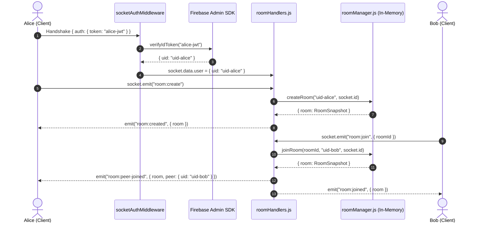

# QuickChat — Video Call Room Management (Backend & Real-Time Protocol)

> Scope: Authenticated Socket.IO handshakes, room creation, joining, leaving, peer notifications, and automatic cleanup. (No WebRTC/SDP/ICE signaling).

---

## Architecture & Zero-Trust Security Model

QuickChat enforces strict server-side identity validation:
1. **No Client Trust**: Client event payloads never contain `uid` or user credentials.
2. **Handshake Verification**: Socket.IO connections are validated against Firebase Admin SDK via `socketAuthMiddleware` before triggering the `connection` event.
3. **Session Binding**: Decoded claims are attached to `socket.data.user`. All business logic in `roomHandlers.js` resolves callers via `socket.data.user.uid`.
4. **Isolated Rooms**: Sockets join room-specific channels (`socket.join(room.id)`), allowing scoped broadcasts without leaking information to non-members.



---

## Files Created / Modified

| File | Purpose |
|---|---|
| [`server.js`](file:///d:/MERN/Antigravity/quickChat/server/server.js) | Lifted `app.listen` → `http.createServer` + Socket.IO init |
| [`src/socket/roomManager.js`](file:///d:/MERN/Antigravity/quickChat/server/src/socket/roomManager.js) | Pure in-memory room store & all room logic |
| [`src/socket/socketAuth.js`](file:///d:/MERN/Antigravity/quickChat/server/src/socket/socketAuth.js) | Socket.IO handshake middleware — verifies Firebase token |
| [`src/socket/roomHandlers.js`](file:///d:/MERN/Antigravity/quickChat/server/src/socket/roomHandlers.js) | Event handlers: `room:create`, `room:join`, `room:leave`, `disconnect` |
| [`src/socket/index.js`](file:///d:/MERN/Antigravity/quickChat/server/src/socket/index.js) | Wires auth middleware + handlers; exports `initSocketIO` |
| [`client/src/services/socketService.js`](file:///d:/MERN/Antigravity/quickChat/client/src/services/socketService.js) | Client-side singleton socket client implementing matching protocol |

---

## Data Structures

### `Room`
```
Map<roomId, Room>

Room {
  id          : string          // 22-char base64url, crypto-random
  hostUid     : string          // Firebase UID of creator (transfers on host leave)
  status      : 'waiting'       // 1 participant — host waiting for peer
             | 'active'         // 2 participants — call in progress
             | 'ended'          // closed; rejected for all new joins
  participants: Map<uid, Participant>
  createdAt   : number          // Date.now()
  endedAt     : number | null
}
```

### `Participant`
```
Participant {
  uid      : string   // Firebase UID — proof of identity from verified token
  socketId : string   // socket.id of the live connection (server-side only)
  joinedAt : number
}
```

### `RoomSnapshot` (sent over the wire)
```json
{
  "id": "mK3z8aQpLx...",
  "hostUid": "firebase-uid-A",
  "status": "active",
  "participants": [
    { "uid": "firebase-uid-A", "joinedAt": 1728999001000 },
    { "uid": "firebase-uid-B", "joinedAt": 1728999020000 }
  ],
  "createdAt": 1728999001000,
  "endedAt": null
}
```
> **Note:** `socketId` is **never** sent to clients. Clients identify peers by `uid` only.

---

## Socket Connection Setup (Client Side)

```js
import { io } from 'socket.io-client';
import { getAuth } from 'firebase/auth';

const token = await getAuth().currentUser.getIdToken();

const socket = io('http://localhost:5000', {
  auth: { token }   // ← token verified server-side in socketAuth.js
});

socket.on('connect_error', (err) => {
  console.error('Auth rejected:', err.message);
});
```

---

## Events Reference

### Events Sent **FROM** Client

#### `room:create`
Create a new room. The caller becomes the host and sole participant.

```js
socket.emit('room:create');
// No payload required — identity comes from the handshake token.
```

#### `room:join`
Join an existing room by ID.

```js
socket.emit('room:join', { roomId: 'mK3z8aQpLx...' });
```

| Field | Type | Required |
|---|---|---|
| `roomId` | `string` | ✅ |

#### `room:leave`
Leave the current room voluntarily.

```js
socket.emit('room:leave');
// No payload required — server looks up the room by UID from token.
```

---

### Events Sent **TO** Client

#### `room:created` → creator only
Emitted after a successful `room:create`.

```json
{
  "room": {
    "id": "mK3z8aQpLx...",
    "hostUid": "uid-A",
    "status": "waiting",
    "participants": [{ "uid": "uid-A", "joinedAt": 1728999001000 }],
    "createdAt": 1728999001000,
    "endedAt": null
  }
}
```

#### `room:joined` → joiner only
Emitted after a successful `room:join`.

```json
{
  "room": {
    "id": "mK3z8aQpLx...",
    "hostUid": "uid-A",
    "status": "active",
    "participants": [
      { "uid": "uid-A", "joinedAt": 1728999001000 },
      { "uid": "uid-B", "joinedAt": 1728999020000 }
    ],
    "createdAt": 1728999001000,
    "endedAt": null
  }
}
```

#### `room:peer-joined` → existing participants
Sent to the host when the second participant joins.

```json
{
  "room": { "...same RoomSnapshot..." },
  "peer": { "uid": "uid-B" }
}
```

#### `room:left` → remaining participant
Sent when one participant leaves but the room is not empty.

```json
{ "roomId": "mK3z8aQpLx...", "uid": "uid-B" }
```

#### `room:ended` → all remaining participants
Sent when the last participant leaves (room is now empty).

```json
{ "roomId": "mK3z8aQpLx..." }
```

#### `room:error` → requesting socket only
Sent on any validation failure.

```json
{ "message": "Room \"mK3z8aQpLx...\" is already full." }
```

---

## Validation Rules

| Scenario | Error message |
|---|---|
| `room:join` with non-existent roomId | `Room "..." does not exist.` |
| `room:join` with ended room | `Room "..." has already ended.` |
| `room:join` when room is full (2 users) | `Room "..." is already full.` |
| `room:join` when already a participant | `You are already a participant in this room.` |
| `room:join` with no/invalid `roomId` field | `room:join requires a roomId string.` |
| `room:create` while already in a room | `You are already in room "...". Leave it before creating a new one.` |
| `room:leave` when not in a room | `You are not currently in a room.` |

---

## Cleanup Behaviour

| Trigger | What happens |
|---|---|
| Last participant calls `room:leave` | Room → `ended`; all sockets notified via `room:ended` |
| A socket disconnects (e.g. browser closed) | `disconnect` handler runs `leaveRoom(uid)` — same logic as `room:leave` |
| Host leaves (1 participant remains) | Host role transfers to the remaining participant; status → `waiting` |
| Ended room | Removed from memory after **5 minutes** via `setTimeout` |

> Rooms are never kept alive by Socket.IO room membership alone. The `roomManager` Map is the single source of truth.

---

## Manual Testing Guide

### Prerequisites
- Server running on port 5000 (`npm run dev` in `server/`)
- Two browser tabs (or two different browsers) logged in as **User A** and **User B**
- A way to run Socket.IO client code (e.g. your existing frontend, or the browser console with socket.io CDN)

---

### Test 1 — Happy Path (create + join)

**User A (Tab 1):**
```js
// 1. Connect with User A's token
const tokenA = await firebase.auth().currentUser.getIdToken();
const socketA = io('http://localhost:5000', { auth: { token: tokenA } });

// 2. Listen for events
socketA.on('room:created',   (data) => console.log('CREATED', data));
socketA.on('room:peer-joined', (data) => console.log('PEER JOINED', data));
socketA.on('room:ended',     (data) => console.log('ENDED', data));
socketA.on('room:error',     (data) => console.error('ERROR', data));

// 3. Create room
socketA.emit('room:create');
// → Expect: room:created { room: { id: "...", status: "waiting", ... } }
// → Copy the room id from the log.
```

**User B (Tab 2):**
```js
const tokenB = await firebase.auth().currentUser.getIdToken();
const socketB = io('http://localhost:5000', { auth: { token: tokenB } });

socketB.on('room:joined', (data) => console.log('JOINED', data));
socketB.on('room:left',   (data) => console.log('LEFT', data));
socketB.on('room:error',  (data) => console.error('ERROR', data));

// Paste the roomId from User A's log
socketB.emit('room:join', { roomId: '<room-id-from-step-3>' });
// → Expect (B): room:joined { room: { status: "active", participants: [A, B] } }
// → Expect (A): room:peer-joined { peer: { uid: "<uid-B>" }, room: {...} }
```

---

### Test 2 — Validation errors

```js
// Non-existent room
socketB.emit('room:join', { roomId: 'doesnotexist123' });
// → room:error: Room "doesnotexist123" does not exist.

// Room already full (after A and B are in it)
const tokenC = /* third user */;
const socketC = io('http://localhost:5000', { auth: { token: tokenC } });
socketC.emit('room:join', { roomId: '<room-id>' });
// → room:error: Room "..." is already full.

// Duplicate join by same user
socketA.emit('room:join', { roomId: '<room-id>' });
// → room:error: You are already a participant in this room.
```

---

### Test 3 — Leave and cleanup

```js
// User B leaves voluntarily
socketB.emit('room:leave');
// → Expect (A): room:left { roomId, uid: "<uid-B>" }
// Room status reverts to "waiting", A becomes host.

// User A also leaves (room is now empty)
socketA.emit('room:leave');
// → Expect (A): room:ended { roomId }
// Room is marked 'ended', removed from memory in 5 min.
```

---

### Test 4 — Disconnect cleanup

```js
// Close Tab B without calling room:leave
socketB.disconnect();
// → Server disconnect handler fires
// → Expect (A): room:left { roomId, uid: "<uid-B>" }
```

---

### Server-side log output to expect
```
Firebase connected successfully
Server running on port 5000
[socket] ✅ Connected  socket=abc123 uid=uid-A
[room:create] uid=uid-A socket=abc123
[room:create] ✅ Room mK3z8aQpLx... created by uid=uid-A
[socket] ✅ Connected  socket=def456 uid=uid-B
[room:join] uid=uid-B socket=def456 roomId=mK3z8aQpLx...
[room:join] ✅ uid=uid-B joined room mK3z8aQpLx... — status: active
```
